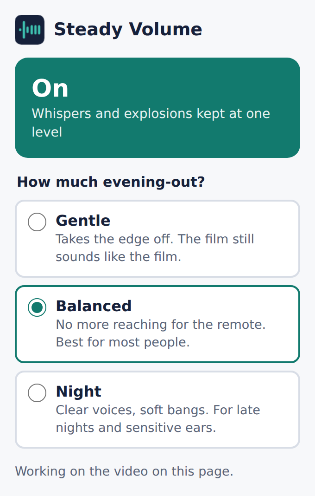
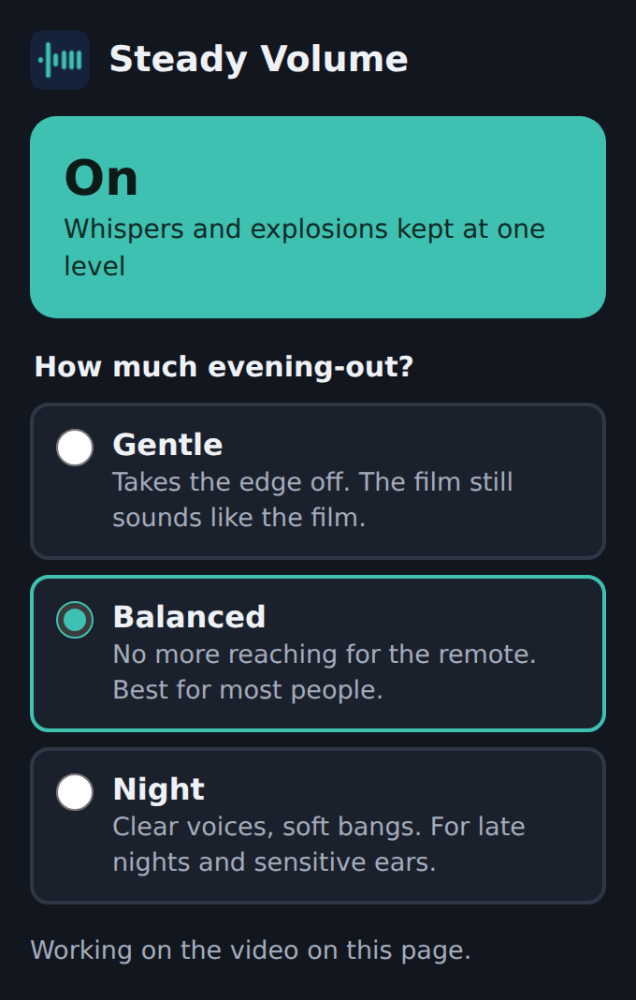

# Steady Volume

**No more whispering, then shouting.** A browser extension that keeps films and TV at one comfortable volume, automatically.

Films are mixed for cinemas. At home, that means you turn it up to hear the dialogue, then an explosion or jump-scare blasts out. This is hard on older viewers, people with hearing loss, anyone easily startled, and anyone with a sleeping household.

Steady Volume fixes that the moment it's installed. There's nothing to set up and no hidden menu to find.

<p>
  
  
</p>

## What it does

Every video and audio player on every site is routed through a broadcast-style loudness chain:

| Stage | What it does | Why it matters |
|---|---|---|
| Rumble cut | Removes deep sub-bass | Takes the physical "thump" out of explosions. Speech has almost none. |
| Dialogue lift | Gentle boost around 2.5 kHz | Makes consonants clearer, which older ears lose first. |
| Leveler | Slowly raises quiet scenes and lowers loud ones | Whispered scenes come up without touching the remote. Holds still in silence, so background hiss isn't pumped up. |
| Compressor | Reacts in milliseconds | Catches the sudden jump from a whisper to a shout. |
| Limiter | Hard ceiling | Nothing gets past it, whatever the film does. |

Measured on a test soundtrack (whisper, explosion, dialogue, jump-scare, quiet dialogue):

| | Gap between quietest and loudest scene |
|---|---|
| Original | **39 dB** (about 15x louder, as heard) |
| Gentle | 18 dB |
| Balanced (default) | 12 dB |
| Night | **9 dB** |

## Try it

**Chrome / Edge / Brave / Opera**

1. Download or clone this repository.
2. Open `chrome://extensions` (or `edge://extensions`).
3. Turn on **Developer mode**.
4. Click **Load unpacked** and pick this folder.
5. Play something on YouTube, Netflix or elsewhere. It's already working.

**Firefox**

1. Open `about:debugging#/runtime/this-firefox`.
2. Click **Load Temporary Add-on** and pick `manifest.json`.
3. Firefox asks for site access for Manifest V3 extensions: click the extension icon and allow it on all sites.

## Develop

```sh
npm install
npm test          # offline audio measurements + real-browser extension checks
npm run icons     # re-render icons/icon.svg to PNGs
npm run package   # zip for the store: dist/steady-volume-<version>.zip
```

| File | Purpose |
|---|---|
| `src/engine.js` | The audio chain and presets. Plain Web Audio, no dependencies. |
| `src/content.js` | Runs on every page, finds players and routes them through the engine. |
| `popup/` | The toolbar popup: one big switch and three presets. |
| `test/offline.test.mjs` | Renders a synthetic soundtrack and checks the numbers above. |
| `test/extension.test.mjs` | Loads the extension into Chromium and checks it on real pages. |

## Known limits

- **Cross-origin players without CORS are skipped.** The browser gives Web Audio silence for these, so capturing them would mute the video. The big streaming services use Media Source streams, which work; some small sites embedding a plain video file from another domain won't be processed.
- **The first sound after opening a page may be unprocessed** until you click or press a key. Browsers don't let audio processing start without a user interaction. Pressing play counts, so in practice it's nearly always immediate.
- **Sites that already use Web Audio on their player** are left alone.
- **Tabs opened before install** need a reload.
- **Safari** needs the extension wrapped in an Xcode project (`xcrun safari-web-extension-converter`) and published through the App Store.
- **Not yet tested by hand** on Netflix, Disney+, Prime Video and similar services. Streaming copy protection should not block this, since those services' audio reaches the page as ordinary Media Source streams, but this needs checking on each service before launch.

## Roadmap

1. Hands-on check on the top streaming services; per-site tuning where needed.
2. Store listings: Chrome Web Store, Edge Add-ons, Firefox Add-ons.
3. "Off on this site" option.
4. Safari build.
5. Beyond the browser: TV is where most target users watch. Options are a smart-TV app, an HDMI audio box, or a guided setup for the TV's own night mode.
